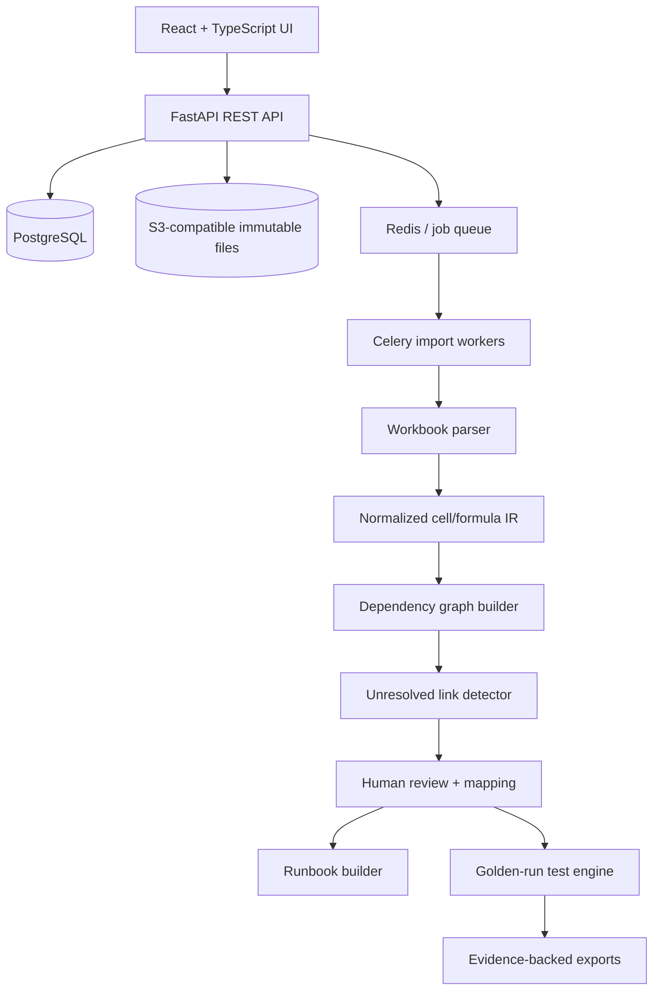

# WorkbookRescue — MVP Technical Specification

**Version:** 0.1.0  
**Status:** Build-ready proposal / customer-validation hypothesis  
**Date:** 2026-11-01  
**Owner:** Founding engineering team  
**Scope:** Read-only recovery of business-critical spreadsheet workflows, with provenance and executable regression tests.

## 1. Executive summary

WorkbookRescue identifies how an operational output is produced across interdependent Excel workbooks, CSV/ERP exports, external references, formulas, named ranges, manual input cells, and documented human handoffs. It produces (1) a lineage graph, (2) an evidence-backed runbook with unresolved steps explicitly marked, and (3) regression fixtures that detect unexpected changes to outputs.

**Primary wedge:** Recovery and reproducibility of a *multi-file business process*—not generic Excel formula auditing or a new spreadsheet editor. Existing products already offer workbook comparison, formula auditing, and dependency graphs. The unproven business hypothesis is that users will pay for cross-file process reconstruction and executable handoff tests.

**First vertical:** Manufacturing quotation and costing processes run through Excel alongside ERP CSV exports.

**Product promise:** “Find every file and human step behind a quotation, document what is known, identify what is missing, and make future changes testable.”

**Not promised:** Automatic inference of undocumented human intent, perfect Microsoft Excel parity, or unattended replacement of ERP/finance controls.

## 2. Evidence, assumptions and falsification

### Observed pain

Reddit manufacturing discussions describe fragile Excel-based processes and workarounds despite ERP adoption. These reports are qualitative discovery leads, not proof of a large addressable market or willingness to pay.

### Assumptions to test

- **A1:** At least 5 of 15 interviewed manufacturing firms run a critical, multi-file Excel process with undocumented manual steps.
- **A2:** At least 3 firms provide permissioned, sanitized workflows with golden outputs.
- **A3:** Existing workbook audit tools do not satisfy their full cross-file handoff and reproducibility requirements.
- **A4:** At least 2 firms authorize a paid recovery pilot (commercial terms to be discovered).
- **A5:** Recovery creates measurable reductions in handoff time and undetected calculation regressions.

### Stop criteria

Stop or pivot if users only need within-workbook formula tracing, if existing tools satisfy the end-to-end workflow, if no one owns the risk/budget, or if no permissioned real dataset is available within 30 discovery conversations.

## 3. Personas and jobs to be done

| Persona | Job | Critical success criterion |
|---|---|---|
| Operations manager | Ensure quotations remain reproducible after key-person departure | Another employee can execute a documented workflow |
| Cost estimator | Understand exactly which inputs influence a quote | Explainable output lineage |
| Finance/controller | Identify workbook changes that affect margin | Reconciliation and regression evidence |
| IT/data engineer | Migrate legacy spreadsheets | Stable dependency export + test fixtures |
| Reviewer | Confirm unknown steps and sign off | Human-reviewed evidence trail |

## 4. Scope and boundaries

### P0 — mandatory MVP

1. Import `.xlsx` and `.xlsm` as **read-only data** (never run macros), plus `.csv` and `.json` manifests.
2. Hash and store immutable source files; create import reports with unsupported elements and external-reference warnings.
3. Parse formulas, cell values, cached results if present, formatting context useful for classification, named ranges, tables, sheet references, and workbook external-link metadata.
4. Build cross-file dependency graph using deterministic extraction plus explicit user-supplied mapping for ambiguous external references.
5. Identify output cells, likely input cells, constants, broken links, formula errors, missing cached values, and unresolved manual steps.
6. Provide graph explorer with source-linked evidence (file → sheet → cell/range → formula).
7. Allow reviewers to declare ordered workflow steps: retrieve ERP export, paste/refresh target, set parameter, review calculation, export quote. Require evidence and owner for each human step.
8. Capture golden runs from known-good artifacts and expected output values.
9. Execute safe regression checks against **provided calculated outputs** and on a restricted, supported formula subset (see Section 10). Never silently claim Excel-calculated parity.
10. Export JSON lineage, Markdown/PDF runbook, and machine-readable test fixtures/results.
11. Record reviewer decisions, analysis version, file hashes, and all changes in append-only audit history.

### P1 — after pilot evidence

- More comprehensive Excel calculation via an isolated, licensed/compatible engine if warranted.
- One ERP connector, selected by pilot demand; P0 remains file-based.
- Batch comparison of successive workflow versions.
- Role-based task assignments, signed review approvals, and scheduled health checks.
- One-click packaging of a reproducible handoff bundle.

### Out of scope

- Browser extension that edits active Excel files; VBA/macro execution; automatic workbook correction; autonomous ERP writes; business-logic invention with LLMs; unrestricted Python execution; Google Sheets live sync; native `.xls` import (explicitly unsupported in P0); actuarial/financial certification; guaranteed semantic reconstruction from values alone.

## 5. Core demo scenario

A fabricated manufacturer maintains 12 linked artifacts:

- `erp_parts_2026-10.csv`: current item cost and unit of measure.
- `supplier_prices_2026-10.csv`: supplier prices and currency.
- `labor_rates.xlsx`: work center rates.
- `machine_cycle_times.xlsx`: operation durations.
- `materials_mapping.xlsx`: customer SKU to ERP SKU.
- `overhead_policy.xlsx`: overhead percentages.
- `shipping_rates.xlsx`: transport cost tiers.
- `fx_rates.csv`: currency conversion.
- `quote_inputs.xlsx`: order quantities, markup, manually entered exceptions.
- `cost_rollup.xlsx`: calculated unit/total cost.
- `margin_review.xlsx`: margin adjustments and approvals.
- `customer_quote.xlsx`: final customer-facing total.

A reviewer links files and records that the estimator manually copies the newest ERP export into `cost_rollup.xlsx::ERP_Import`, then sets an override for an urgent purchase. The system must show which final quote totals depend on these actions, which relationships were automatically evidenced, and which were reviewer-declared.

### Golden fixture

Use deliberately synthetic values, not production pricing. Suggested single order:

- 100 units; materials ₹400/unit; labor ₹150/unit; overhead ₹50/unit; shipping ₹2,000 total; quoted margin policy 20% markup (not gross-margin percentage).
- Expected total cost = `100*(400+150+50)+2000 = ₹62,000`.
- Expected quote = `₹62,000*1.20 = ₹74,400`.
- A changed labor rate must trigger a failed/changed baseline, with the exact path back to the labor-rate file.

**Important:** Financial terminology and rounding policy must be explicit in the fixture. Store currency, units, precision, tax policy, and whether the rate is markup vs margin.

## 6. UX specification

### Navigation

1. **Projects**: list, owner, most recent import, unresolved blockers.
2. **Workflow workspace**: artifact inventory, process overview, latest analysis.
3. **Lineage explorer**: clickable file/sheet/cell graph and typed edges.
4. **Unknowns queue**: broken links, missing files, inferred/manual steps needing confirmation.
5. **Golden runs**: baseline creation, input manifest, output assertions, diff results.
6. **Runbook**: ordered steps, evidence, owner, version, approval, export.

### Primary workspace layout

- **Left 22%**: artifact tree: workbook → sheet → ranges; filters for unresolved and high-impact.
- **Center 53%**: zoomable lineage graph with output-first trace, edge labels and provenance.
- **Right 25%**: inspector with cell address, formula text, cached value, references, source hash, analysis confidence, and review controls.
- **Bottom drawer**: findings, regression failures, supporting evidence.

### Important interactions

- Select a final quote output → highlight all upstream dependency paths.
- Click an external link → open file mapping decision, showing raw formula and resolved/unresolved candidates.
- Select a human task → show declared owner, prerequisites, evidence and validation status.
- Run baseline comparison → exact changed outputs, tolerances, inputs involved, and reasons for inconclusive evaluation.
- Export only if all blocking unknowns are resolved or an explicit *incomplete* report is acknowledged.

### Design treatment

Functional engineering UI, not chat-centric. Use neutral surfaces, monospace cell paths, restrained status colors. Status labels: **Verified**, **User-declared**, **Inferred**, **Unresolved**, **Unsupported**. Never treat inferred as verified.

## 7. System architecture



### Stack

- Frontend: React 19, TypeScript, Vite, React Flow, TanStack Query, Tailwind CSS, Playwright.
- Backend: Python 3.12, FastAPI, Pydantic v2, SQLAlchemy 2, Alembic.
- Extraction: `openpyxl` for XLSX/XLSM structure and formulas, with separate `data_only=True` read for cached values; CSV `python` parser, `formulas` tokenizer or custom restricted tokenizer as needed.
- Async: Celery + Redis (single worker in initial local deployment).
- Storage: PostgreSQL 16 + MinIO locally; S3-compatible cloud storage after security review.
- Testing: pytest, Hypothesis, golden fixtures, Playwright.
- Telemetry: structured logs, OpenTelemetry, Prometheus metrics.

**Security note:** A `.xlsm` file is parsed without executing VBA. Macros, Power Query connections, external data refresh, dynamic arrays, some functions and volatile formulas are unsupported or restricted. Spreadsheet content is untrusted input.

## 8. Data model

Use UUID keys throughout. All tables have `organization_id`; enforce isolation in queries and policies.

| Table | Important fields |
|---|---|
| `organizations` | `id`, `name` |
| `projects` | `id`, `organization_id`, `name`, `status` |
| `artifacts` | `id`, `project_id`, `sha256`, `filename`, `mime_type`, `size_bytes`, `storage_key`, `uploaded_by` |
| `artifact_versions` | `id`, `artifact_id`, `version_label`, `import_run_id`, `created_at` |
| `import_runs` | `id`, `project_id`, `parser_version`, `status`, `warnings_json`, `started_at`, `completed_at` |
| `sheets` | `id`, `artifact_version_id`, `name`, `hidden_state` |
| `cells` | `id`, `sheet_id`, `address`, `formula`, `literal_json`, `cached_json`, `number_format`, `status` |
| `named_ranges` | `id`, `artifact_version_id`, `name`, `definition`, `scope` |
| `dependency_nodes` | `id`, `run_id`, `kind`, `artifact_version_id`, `sheet_id`, `address`, `metadata_json` |
| `dependency_edges` | `id`, `run_id`, `source_node_id`, `target_node_id`, `type`, `provenance`, `confidence`, `status` |
| `mapping_decisions` | `id`, `run_id`, `raw_reference`, `resolved_target_id`, `reviewer_id`, `reason`, `created_at` |
| `workflow_steps` | `id`, `project_id`, `ordinal`, `kind`, `instructions`, `owner_role`, `evidence_ref`, `status` |
| `baseline_runs` | `id`, `project_id`, `manifest_sha256`, `created_by`, `engine_version`, `approval_status` |
| `assertions` | `id`, `baseline_run_id`, `node_id`, `expected_json`, `tolerance_json`, `comparison_mode` |
| `test_runs` | `id`, `baseline_run_id`, `actual_manifest_sha256`, `status`, `results_json` |
| `review_decisions` | `id`, `project_id`, `subject_type`, `subject_id`, `decision`, `reviewer_id`, `reason` |
| `audit_events` | `id`, `organization_id`, `actor_id`, `action`, `object_type`, `object_id`, `payload_hash`, `created_at` |

**Graph direction:** `source -> dependent` means a dependent output is affected by a source. Node identifiers must incorporate artifact version + sheet + address. Cross-workbook references must bind to an explicit artifact version for reproducible runs.

**Indexes:** `(project_id, sha256)` for artifacts; `(run_id, source_node_id)` and `(run_id, target_node_id)` for edges; `(sheet_id, address)` unique for cells; `(organization_id, created_at)` for audit history.

## 9. Extraction, lineage and uncertainty

### Import pipeline

1. Validate file signature, extension, size, archive limits, and declared encoding.
2. Hash original bytes; store immutable original.
3. Detect workbook metadata, worksheets, defined names, tables, formulas, cached values, external links and connection features.
4. Normalize references to internal representation (IR) while preserving exact original formula and address.
5. Emit parse warnings at **file**, **sheet**, **cell** and **feature** levels.
6. Resolve internal references; external references remain unresolved until explicit mapping or strong identifier match with audit trail.
7. Generate graph and summarize incomplete paths.

### Formula intermediate representation

```json
{
  "kind": "formula_cell",
  "artifact_version_id": "uuid",
  "sheet": "Costing",
  "address": "F17",
  "formula_original": "=SUM(C17:E17)*$B$3",
  "references": ["Costing!C17:E17", "Costing!B3"],
  "cached_result": {"kind": "number", "value": "744.00"},
  "unsupported_features": [],
  "provenance": "formula_parse"
}
```

### Edge types

`formula_reference`, `named_range_reference`, `external_workbook_reference`, `manual_copy`, `export_import`, `override`, `reviewed_mapping`, `documented_handoff`.

### Confidence/status semantics

- **Verified**: directly extracted formula/reference or reviewer-confirmed observed relationship.
- **User-declared**: explicitly documented handoff with accountable reviewer.
- **Inferred**: candidate relationship from filenames, headers, matching values, etc.; cannot silently serve as truth.
- **Unresolved**: cannot resolve target or missing dependency.
- **Unsupported**: parser/calculation feature unsupported.

Do not apply a single opaque percentage to all evidence types. Show the matching method and reason instead.

### Dependency algorithm

- Extract reference tokens using an AST-aware parser.
- Expand ranges lazily for graph performance; use range nodes instead of millions of cell edges where appropriate.
- Reconcile references by normalized workbook path/name plus immutable hash/version mapping.
- Find cycles with strongly connected components; mark as potential iterative-calculation dependency and refuse unsupported evaluation.
- For selected output, perform reverse traversal to produce an ancestor subgraph and a topologically ordered runbook where acyclic.
- Store every inferred or manually asserted edge separately from extracted formula edges.

## 10. Regression testing specification

### Two supported modes

**Mode A — observed-output comparison (P0, default).** Customer supplies a known-good workbook with cached results/output snapshot, and a new candidate workbook/output snapshot. Compare declared output cells with typed rules and tolerances. This verifies differences in *observed outputs*, not correct execution of unknown Excel logic.

**Mode B — restricted deterministic formula evaluator (P0 experimental).** Evaluate only explicitly supported arithmetic operators, references, `SUM`, `MIN`, `MAX`, `IF`, and `ROUND` for numeric, acyclic examples. Unsupported functions, external data refresh, ambiguous types, volatile functions, macros, circular references and missing inputs must return `INCONCLUSIVE` or `UNSUPPORTED`, never `PASS`.

### Assertion types

- Numeric absolute tolerance, relative tolerance, exact decimal scale.
- String exact / normalized match.
- Date match with explicit date system/timezone policy.
- Currency amount with explicit currency and rounding mode.
- Required nonblank output.
- Structural check: missing references, changed formulas, changed file checksum.

### Results

`PASS`, `FAIL`, `INCONCLUSIVE`, `UNSUPPORTED`, `ERROR`.

A test report must list input manifest, source hashes, evaluator version, observed actual, expected, tolerance, source cells, and unresolved dependencies. Never assert a workflow is validated when there are blocking inconclusive checks.

### Example baseline manifest

```yaml
schema_version: 1
workflow: manufacturing_quote_demo
inputs:
  - file: erp_parts_2026-10.csv
    sha256: <fixture-hash-at-generation>
  - file: cost_rollup.xlsx
    sha256: <fixture-hash-at-generation>
outputs:
  - path: customer_quote.xlsx::Quote!G24
    type: currency
    currency: INR
    expected: "74400.00"
    absolute_tolerance: "0.01"
    policy: markup_20_percent
review:
  status: pending
  human_steps_verified: false
```

## 11. API contract (v1)

All endpoints authenticated; all IDs organization-scoped. Long tasks return `202 Accepted` and a job ID. Requests use idempotency keys where retries could duplicate state.

| Method | Path | Behavior |
|---|---|---|
| `POST` | `/v1/projects` | Create workspace |
| `GET` | `/v1/projects/{project_id}` | Read project state |
| `POST` | `/v1/projects/{project_id}/artifacts/presign` | Get scoped upload URL |
| `POST` | `/v1/projects/{project_id}/artifacts/complete` | Verify hash and finalize upload |
| `POST` | `/v1/projects/{project_id}/imports` | Start extraction/lineage job |
| `GET` | `/v1/imports/{run_id}` | Get progress and warnings |
| `GET` | `/v1/imports/{run_id}/graph?output_node_id=...` | Output-first dependency subgraph |
| `GET` | `/v1/imports/{run_id}/unknowns` | Unresolved/unsupported findings |
| `POST` | `/v1/imports/{run_id}/mappings` | Record external-link mapping decision |
| `POST` | `/v1/projects/{project_id}/workflow-steps` | Declare human handoff step |
| `POST` | `/v1/projects/{project_id}/baselines` | Create golden baseline |
| `POST` | `/v1/baselines/{baseline_id}/test-runs` | Run verification |
| `GET` | `/v1/test-runs/{test_run_id}` | Fetch traceable results |
| `POST` | `/v1/projects/{project_id}/reviews` | Record human decision |
| `POST` | `/v1/projects/{project_id}/exports` | Export runbook, graph and tests |

Example import result:

```json
{
  "run_id": "example-run-id",
  "status": "completed_with_warnings",
  "artifact_count": 12,
  "verified_edges": 256,
  "user_declared_edges": 3,
  "unresolved_references": 4,
  "unsupported_features": ["POWER_QUERY_REFRESH"],
  "safe_to_claim_reproducible": false
}
```

### Standard errors

Use `application/problem+json`. Error codes include `IMPORT_UNSUPPORTED_FORMAT`, `EXTERNAL_LINK_UNRESOLVED`, `CACHE_MISSING`, `FORMULA_UNSUPPORTED`, `CYCLIC_DEPENDENCY`, `BASELINE_NOT_APPROVED`, `ARTIFACT_HASH_MISMATCH`, `ORG_ACCESS_DENIED`.

## 12. Security, privacy and safety

- Treat spreadsheet formulas, names, cell text, comments and external links as hostile input; no formula evaluation in host Python or shell.
- Never execute macros, embedded OLE objects, Power Query, or external workbook refresh.
- Defend against ZIP bombs, huge shared-string tables, malicious XML, path traversal and CSV formula injection on export.
- Read-only imports. No writes to original workbooks or ERP systems in P0.
- Tenant-scoped access (RBAC: owner, analyst, reviewer, viewer); audit every download.
- Encrypt objects in transit and at rest; signed upload/download URLs expire quickly.
- Default 30-day trial data retention, configurable deletion, and explicit opt-in for keeping golden fixtures.
- Do not transmit customer workbook contents to external LLM APIs in P0.
- Restrict outbound worker networking to avoid SSRF/exfiltration through embedded links.
- Avoid logging actual cell values and sensitive filenames; use request IDs and hashes.
- Package exports with spreadsheet-injection-safe escaping, and mark uncertain steps visibly.
- Authenticated reviewer approvals must be version-bound, append-only and revocable through new audit events rather than overwrites.

## 13. Non-functional requirements

| Area | P0 target / constraint |
|---|---|
| Workload | Up to 20 files/project, 25 MB/file, 250k non-empty cells/project in a bounded initial benchmark |
| Import latency | <= 60 seconds p95 for defined 12-file fixture on reference machine; benchmark, not guaranteed |
| Lineage query | <= 2 seconds p95 for <= 10k-node output subgraph |
| Reliability | Worker jobs retry idempotently; partial failure must not report success |
| Determinism | Same source hashes, mappings and parser version → same graph fingerprint |
| Audit | Every mapping, baseline approval and test run attributable and immutable |
| Observability | Import success, unsupported feature counts, unresolved references, query latency |
| Availability | Local Docker Compose prototype; production SLO deferred until pilot |
| Accessibility | Keyboard-accessible inspector and WCAG 2.2 AA-oriented frontend |

## 14. Benchmark and test dataset

Generate entirely synthetic manufacturing examples. Do not use copyrighted/customer data without permission.

| Group | Test count | Goal |
|---|---:|---|
| Formula references / named ranges | 35 | Precise lineage |
| Multi-workbook external references | 30 | Mapping and unresolved cases |
| CSV/ERP export joins | 25 | Explicit user-confirmed links |
| Manual overrides and handoffs | 20 | Preserve declared vs verified |
| Formula type/rounding regression | 30 | Reliable results and tolerances |
| Invalid/corrupted/malicious files | 25 | Safe failure |
| Graph cycles/large ranges | 20 | Bounded processing |
| Missing cached values/unsupported formula | 25 | Correct inconclusive results |
| **Total** | **210** | Versioned deterministic benchmark |

### Fixture directory structure

```text
fixtures/
  manufacturing_quote/
    inputs/
      erp_parts_2026-10.csv
      supplier_prices_2026-10.csv
      fx_rates.csv
      labor_rates.xlsx
      ...
    manifest.yaml
    expected_graph.json
    expected_unknowns.json
    golden_outputs.json
    scenarios/
      labor_rate_changed/
      missing_erp_export/
      broken_external_link/
      manual_override_changed/
```

### Evaluation metrics

- Edge precision and recall, separately for direct formula references and cross-workbook manual mappings.
- Unresolved-reference detection recall.
- Regression failure detection precision and recall for supported assertions.
- Rate of **false PASS** on incomplete workflows: target zero on labeled benchmark.
- Human task capture completeness on ground-truth process documents.
- Time for an unfamiliar employee to reproduce a quote using exported runbook.

## 15. Acceptance tests (Given / When / Then)

1. **Formula lineage** — Given `=SUM(C17:E17)*$B$3`, when imported, then the graph links the formula cell to the referenced range and cell with exact source provenance.
2. **Broken external link** — Given a formula pointing to a missing workbook, when imported, then mark `UNRESOLVED`; do not infer a verified edge from similar filenames alone.
3. **Version pinning** — Given two ERP exports with the same display filename, when a baseline is created, then it uses an immutable content hash and selected version.
4. **Manual override** — Given an undocumented manually pasted value, when a reviewer adds a handoff, then store it as `USER_DECLARED` with owner and evidence, not `VERIFIED` formula lineage.
5. **Regression failure** — Given a golden quote of ₹74,400 and a new supported observed output of ₹77,400 with tolerance ₹0.01, then return `FAIL` and show changed lineage inputs.
6. **Missing cache** — Given a formula with no cached result and unsupported evaluation, then return `INCONCLUSIVE`, never `PASS`.
7. **VBA safety** — Given `.xlsm`, when imported, then macros are never executed; list macro presence as warning.
8. **Isolation** — Given a user in organization A, when querying organization B's project or object URL, then deny access.
9. **Determinism** — Given identical input hashes and mapping decisions, when rerun with same engine, then graph hash and results match.
10. **Audit** — Given an approved baseline is revised, then retain prior approval and record a new superseding event.
11. **Large range** — Given a formula referencing 100k cells, then use range-node or bounded traversal; do not generate unbounded memory use.
12. **Export honesty** — Given unresolved external dependencies, then every exported summary prominently indicates *INCOMPLETE*.

## 16. Implementation roadmap

### Sprint 0 — discovery and technical spike (days 1–3)

- Recruit five manufacturing operators/estimators; obtain consent and sanitized examples.
- Confirm file types, macros, external references, manual steps, golden outputs.
- Spike `openpyxl` extraction on representative files and document unsupported cases.
- Freeze P0 import contract and reference fixture.

**Exit:** At least one complete, permissioned sample workflow or a synthetic substitute explicitly marked as nonvalidated.

### Sprint 1 — immutable imports and IR (days 4–7)

- Monorepo scaffold, Docker Compose, Postgres/MinIO, auth, file hashing, worker queue.
- XLSX/XLSM/CSV importer, formula preservation, cached values, warning taxonomy.
- Unit tests and structured import diagnostics.

**Exit:** Import 12-file synthetic workflow without executing external content.

### Sprint 2 — lineage graph and unknowns (days 8–11)

- AST/reference parser, defined names, range nodes, cross-file mapping wizard.
- Graph APIs, output-first reverse traversal, provenance labels.
- Golden graph fixture validation.

**Exit:** Demonstrate correct paths and explicit unresolved references.

### Sprint 3 — baseline and tests (days 12–15)

- Output declaration, baseline approval, observed-output comparisons.
- Restricted arithmetic evaluator for supported fixture operations.
- Inconclusive/unsupported result handling; change reason report.

**Exit:** Detect controlled labor-rate change and refuse false pass when cache missing.

### Sprint 4 — reviewer interface and runbook (days 16–19)

- React Flow UI, inspector, unknowns queue, human step editor.
- Audit timeline, Markdown/PDF/JSON export, accessibility checks.

**Exit:** Another user can follow exported synthetic runbook and reproduce expected output.

### Sprint 5 — pilot hardening (days 20–24)

- File fuzzing, security review, edge-case benchmark, performance profiling.
- Three customer workflow trials if accessible; record actual time-to-handoff.
- Prepare paid audit offer and willingness-to-pay interviews.

**Exit:** Meets Section 17 gates; otherwise narrow unsupported file class or stop.

## 17. Release gates

**Functional gates:** Import + graph + baseline + reviewer runbook + export work end to end; unsupported features are visible; all 12 acceptance scenarios pass.

**Safety gates:** Zero macro execution, no outbound document refresh, zero cross-tenant access in access tests, zero false `PASS` in labeled incomplete cases.

**Quality gates:** >= 95% direct formula edge recall and >= 98% direct formula edge precision on supported benchmark; 100% unresolved-link flags for labeled missing external links. These are targets, not achieved results.

**Customer gates:** 15 interviews, 3 qualified workflows, 2 paid-pilot commitments or clear proof of budget authority. Don't assume a startup thesis is validated by benchmark accuracy alone.

## 18. Differentiation and commercial model

### Competitive reality

Spreadsheet lineage and workbook comparisons are established capabilities in PerfectXL, Incisive, Microsoft Inquire and others. The hypothesis worth testing is *operational continuity across files and human handoffs* plus reproducible acceptance tests.

### Differentiation test

In every sales interview, ask to perform the task in the customer's current tool: “Can you produce a verified, repeatable handoff for an inherited 12-file quoting process, showing manual ERP steps and a failing test when an upstream rate changes?” If the incumbent can do this with reasonable effort, that customer is not a wedge.

### Initial offer

Service-assisted paid recovery audit for one workflow, then optionally productize recurring validation. Price is discovered through bids and interviews; do not assume a generic SaaS price before establishing buyer and risk.

## 19. Risks and mitigations

| Risk | Mitigation |
|---|---|
| Excel formula engine parity impossible in P0 | Default to observed outputs, explicit `INCONCLUSIVE`, restricted evaluator |
| External links point to missing files | User mapping + prominent unresolved status |
| Manual operations invisible to files | Reviewer-declared handoffs with owners/evidence |
| Input files contain proprietary or personal data | Local/self-hosted pilot, retention controls, no external LLM |
| Incumbents already solve problem | Test their demos against full workflow before investing |
| Graph too large to render | Output-centered subgraphs, virtualized nodes, range compression |
| Spreadsheet logic can be unsafe or legally consequential | No autonomous changes, approvals and limited claim language |
| Golden outputs may themselves be wrong | Explicitly label golden as *customer-approved*, not mathematically correct |

## 20. Implementation repository scaffold

```text
workbookrescue/
  apps/
    web/
      src/pages/{Projects,Workspace,Lineage,Unknowns,Baselines,Runbook}.tsx
      src/components/{ArtifactTree,LineageGraph,CellInspector,ReviewPanel}.tsx
    api/
      app/{main.py,config.py,auth.py}
      app/routes/{projects,artifacts,imports,graph,mappings,baselines,exports}.py
      app/models/
      app/schemas/
      app/services/{ingest,lineage,review,regression,export}.py
      app/workers/
  packages/
    workbook_ir/
      parser.py
      references.py
      types.py
    graph_engine/
      builder.py
      resolver.py
      traversal.py
    safe_evaluator/
      supported_functions.py
      evaluator.py
  fixtures/
    manufacturing_quote/
  tests/
    unit/
    integration/
    security/
    e2e/
  infra/
    docker-compose.yml
    migrations/
  docs/
    spec.md
    api.openapi.yaml
    security.md
    evaluation.md
  README.md
```

## 21. Definition of done for the first demo

The demo operator uploads 12 synthetic artifacts, selects `customer_quote.xlsx::Quote!G24`, sees all supported formula dependencies, resolves an external ERP mapping, documents one manual import and an override, creates a golden snapshot of ₹74,400, changes the labor rate, receives a traceable failed comparison, and exports a handoff runbook marked with its approval and uncertainty state.

**Final product boundary:** The system **documents and tests what is evidenced**. It does not claim to understand undocumented business processes until a human confirms them.
